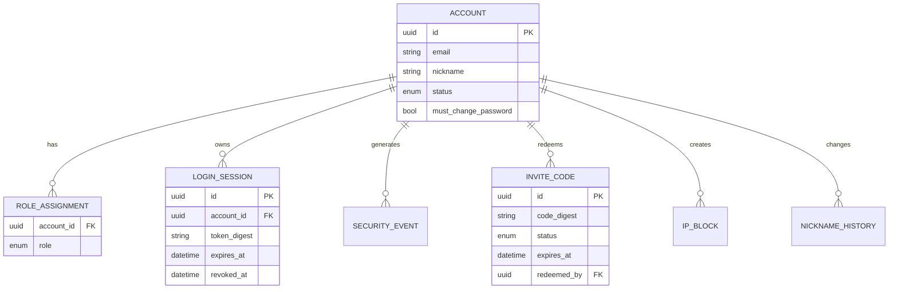
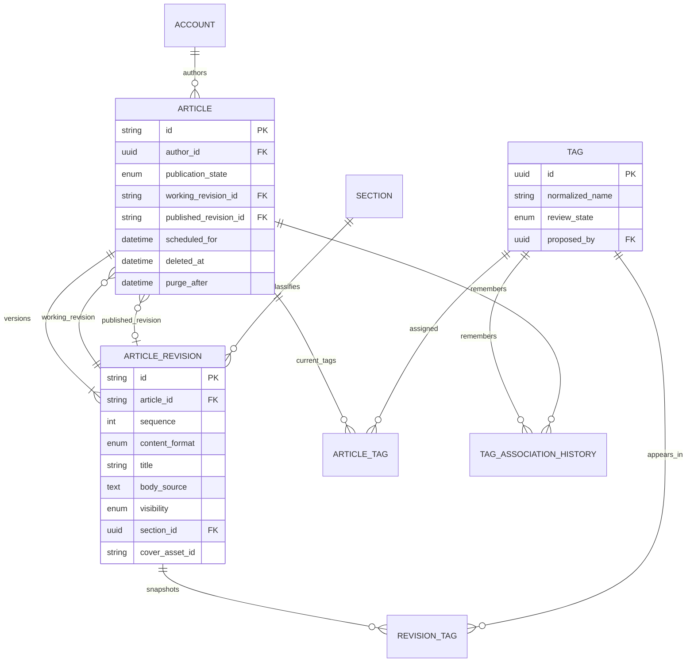
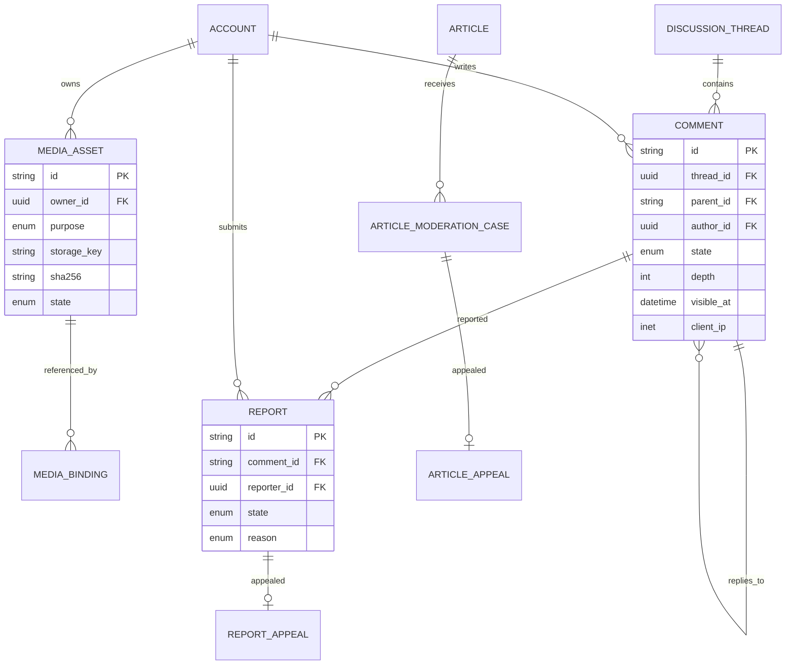
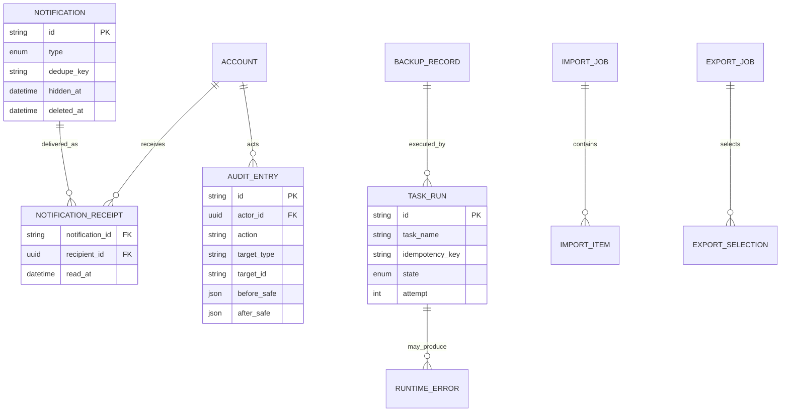
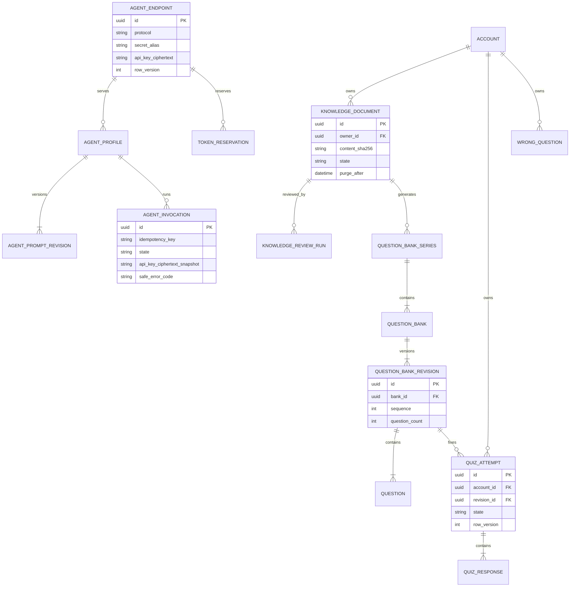

# 关系模型与聚合边界

本文定义逻辑 ER 模型。它先回答“谁拥有事实”，不代替 Django migration；字段、约束和索引分别见本目录后续文档。

## 建模原则

1. PostgreSQL 是业务事实来源；Redis 中的验证码、冷却和限流都可丢失。
2. 跨领域只引用稳定公开标识，不从一个 app 修改另一个 app 的私有表。
3. 文章修订不可变；`Article` 只保存当前工作修订和当前发布修订的指针。
4. 管理员隐藏、作者禁用、软删除是三种独立遮罩，不覆盖文章原可见性。
5. 评论删除保留占位，文章到期物理删除时才级联删除评论正文和图片。
6. 审计、举报、申诉、运行错误和任务记录不随业务对象物理删除。

## 账户与访问

验证码本体、登录失败计数和每日发送计数不建业务表；它们保存在 Redis。每次请求与校验产生脱敏的 `SecurityEvent`，用于永久 IP 追溯和管理员调查。

## 内容、版本与分类

`ARTICLE_REVISION` 保存标题、正文、格式、封面、可见性、分区、标签和评论设置的完整快照。`ARTICLE_TAG` 是当前高频查询投影；它必须由内容服务与修订事务同步维护，不能由视图直接写。

## 媒体、讨论与审核

`DiscussionThread` 统一承载文章评论区和留言板，但线程的目标类型只能是注册表中的 `ARTICLE` 或 `GUESTBOOK`。举报与文章管理申诉属于 `moderation`，评论树本身属于 `comments`。

## 通知、运维与交换

## AGENT、知识题库与学习记录

`AgentEndpoint`、`AgentProfile`、`AgentPromptRevision`、`AgentInvocation` 与 token ledger/reservation/adjustment/reset operation 属于 agents；`KnowledgeDocument`、审核/生成运行、题库、答题和错题属于 learning。下图使用数据库逻辑名，具体字段在对应 migration Todo 固化。

Endpoint/Prompt/invocation 不引用 learning 私有 ID 以外的安全 caller ref；knowledge review/generation 只保存 invocation/TaskRun 稳定引用。题库标签由 learning 独占，不与 content `TAG` 建外键。QuizResponse/WrongQuestion 保存解释历史所需的题面、选项、答案/参考答案与解析安全快照，允许题库最终清理后外键置空。

## 聚合写入边界

| 聚合 | 唯一写入口 | 同事务内允许写入 |
| --- | --- | --- |
| Account | `accounts.services` | 账户、角色、会话撤销、安全事件、outbox |
| Article | `content.services` | Article、Revision、当前标签投影、发布 outbox |
| MediaAsset | `media.services` | Asset、Binding、清理状态 |
| CommentThread | `comments.services` | Comment、回复计数、媒体解绑、outbox |
| ModerationCase | `moderation.services` | Report/Appeal 或 ArticleCase/Appeal、裁决 outbox |
| Notification | `notifications.services` | Notification、Receipt |
| Import/Export | `exchange.services` | Job、Item/Selection、TaskRun 引用 |
| AgentConfiguration/Invocation | `agents.services` | Endpoint、Profile、Prompt revision、Invocation、token ledger/reservation/adjustment/reset operation、审计/outbox |
| KnowledgeDocument | `learning.services` | Document、review run、appeal/access、媒体绑定意图、outbox |
| QuestionBank | `learning.services` | Series、Bank、immutable revision、Question、learning tag/coverage、generation run、outbox |
| QuizLearning | `learning.services` | Attempt、Response、WrongQuestion、记录删除状态 |

跨聚合副作用通过事务 outbox 事件完成。事务提交前不直接发送邮件、不入 Celery、不删除文件，防止数据库回滚后外部副作用已经发生。
