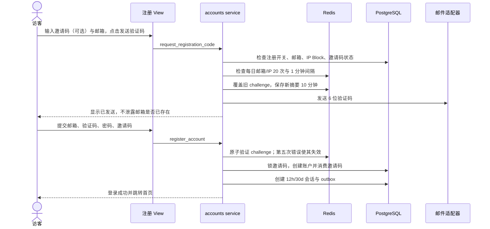
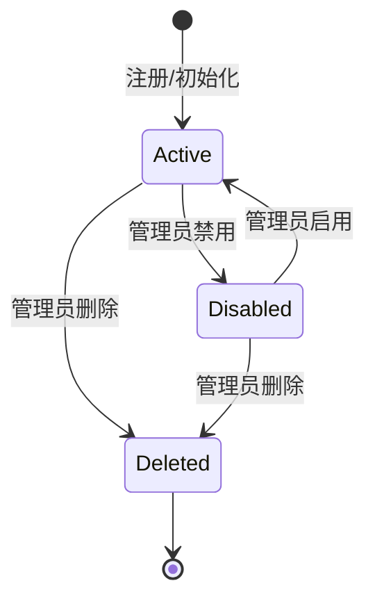
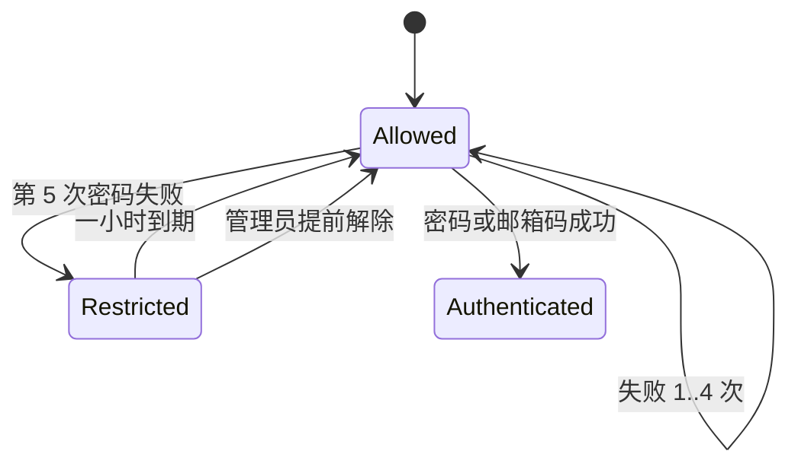

# 账户、注册与访问状态机

## 注册时序



邀请码在“账户创建事务成功”前不消费。验证通过后数据库唯一冲突仍可能发生，服务必须返回字段级冲突并保持邀请码可用。

## 账户状态



| 转换 | 同步副作用 | 异步副作用 |
| --- | --- | --- |
| 注册 | 建账户、角色、会话、安全事件；邀请注册消费邀请码 | 欢迎通知首版可不做 |
| 禁用 | 撤销全部会话；已排期文章转草稿 | 隐藏已发布文章投影、永久审计 |
| 启用 | 恢复登录能力 | 恢复仅因禁用而隐藏的文章、永久审计 |
| 删除 | 校验非管理员；处理作者文章；移除私有资料 | 关闭举报、清理媒体、审计 |

禁用不隐藏历史评论，也不发送账号通知。删除立即释放邮箱和昵称，新账户获得全新 UUID，不能重新关联历史评论。

## 角色状态

- 普通用户通过管理员动作获得 `AUTHOR`；撤销后不能新建、编辑、发布，但既有文章仍归其所有。
- 唯一管理员始终同时是作者；不能撤销其作者角色、不能删除自己、不能创建第二个管理员。
- 角色授予/撤销必须站内通知用户并永久审计。

## 登录与临时限制



一小时限制按账户/规范化邮箱生效，阻止密码登录、邮箱码登录和密码重置；页面明确显示“该账号暂时限制登录”。密码成功后清零连续失败计数。IP 永久封禁的优先级更高，统一显示“当前网络暂时受限”。

## 验证码状态

```text
ISSUED --正确--> CONSUMED
ISSUED --10 分钟--> EXPIRED
ISSUED --重发--> SUPERSEDED
ISSUED --第 5 次错误--> INVALIDATED
```

挑战按用途隔离：注册、验证码登录、密码重置、新邮箱验证不能混用。同一邮箱同一用途新码使旧码失效；码与发送邮箱绑定。验证码摘要、尝试数和过期保存在 Redis，服务重启导致其失效是允许行为。

## 会话状态

| 事件 | 当前会话 | 其他会话 |
| --- | --- | --- |
| 普通登录 | 创建 12 小时会话 | 不影响 |
| 勾选 30 天 | 创建 30 天会话 | 不影响 |
| 登录态改密 | 旋转令牌并保持 | 全部撤销 |
| 邮箱修改 | 保持并旋转令牌 | 保持；下次敏感动作读取新邮箱 |
| 密码重置 | 不保留 | 全部撤销 |
| 禁用/删除 | 撤销 | 全部撤销 |
| 退出指定设备 | 若命中则撤销 | 仅目标 |
| 退出所有设备 | 撤销 | 全部撤销 |

页面只展示会话 ID、设备/浏览器摘要、登录时间、最后活动时间和掩码 IP；认证 Cookie 中是随机原始令牌，数据库只存摘要。

## 邮箱与密码修改

- 新邮箱：登录态 + 新邮箱验证码即可，不要求旧邮箱或当前密码；成功后大小写不敏感唯一。
- 登录态改密：必须输入当前密码，不需要邮箱码；成功后当前凭证旋转、其他会话撤销。
- 忘记密码：验证已绑定邮箱的密码重置码；成功后所有会话撤销。
- 首次管理员：部署时从 `.env` 读取一次性强随机密码，数据库只存哈希；首次登录强制改密，之后引导密钥永不复用。

## 服务端判定顺序

每个需要身份的请求按固定顺序裁决：

1. 解析真实客户端 IP，并检查永久 `IpBlock`。
2. 验证会话摘要、撤销和过期时间。
3. 检查账户是否存在且为 `ACTIVE`。
4. 检查动作所需角色与对象权限。
5. 检查临时限流、磁盘门禁和业务状态。
6. 执行事务并写安全事件/审计/outbox。

顺序固定可以避免同一用户在普通页面、HTMX 和任务入口得到不同授权结果。
