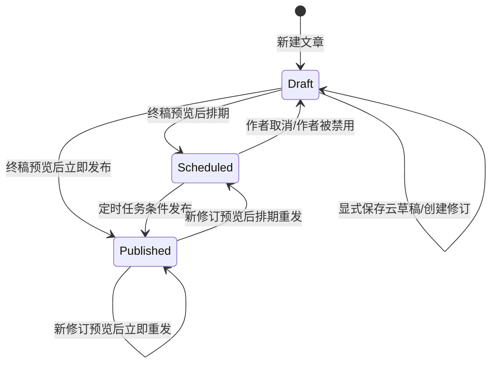
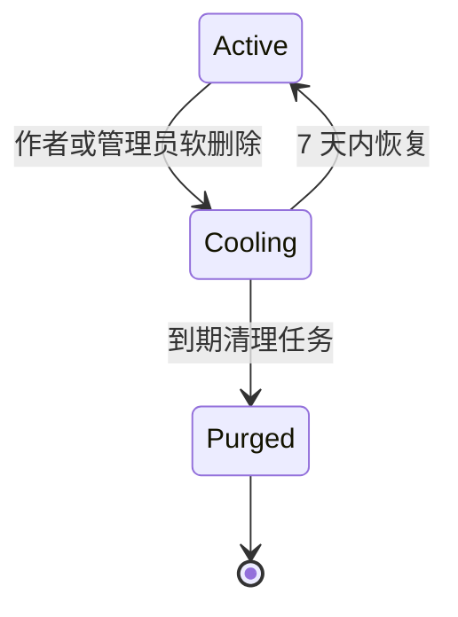
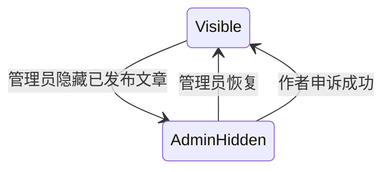
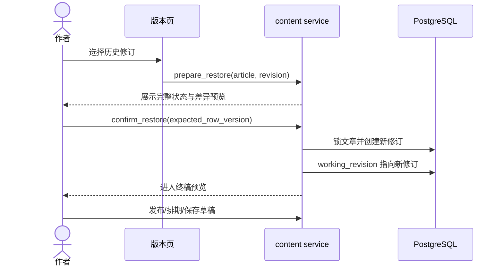

# 文章、修订与管理遮罩状态机

文章有三组正交状态：发布状态、删除状态、管理/账户遮罩。实现必须分别保存，不能压成一个枚举。

## 发布状态

`publication_state` 描述文章流程，真正的可读正文由 `published_revision_id` 决定。已发布文章编辑期间，`working_revision_id != published_revision_id`，不会改变读者内容。

## 创建、保存与发布命令

| 命令 | 前置条件 | 原子写入 | 提交后副作用 |
| --- | --- | --- | --- |
| `create_article` | Author；磁盘不低于 2% | Article + 首修订，默认大众/草稿/评论开启/评论无需登录 | 无 |
| `save_cloud_draft` | 作者本人；版本令牌一致 | 新不可变修订，切 working 指针 | 本地草稿由浏览器收到成功后清除/更新 |
| `open_final_review` | 作者本人；当前工作修订可渲染 | 不写业务状态 | 生成安全预览 |
| `publish_now` | 已完成终稿预览；分区或允许的导入例外 | 切 published 指针、状态 Published、更新时间 | 缓存失效、通知/审计事件 |
| `schedule_publish` | 时间晚于现在；同上 | 锁定 scheduled_revision、时间和状态 | 入任务调度 |
| `republish` | 已发布且工作修订不同 | 切 published 指针，保留首次 published_at | 缓存失效 |

文章格式创建时选定且普通编辑不可改。Markdown 导入覆盖富文本、历史恢复富文本修订是显式例外，必须在审计/版本元数据中记录原因。

## 可见性

| 修订可见性 | 访客 | 登录用户 | 作者 | 管理员 |
| --- | --- | --- | --- | --- |
| PUBLIC | 允许 | 允许 | 允许 | 允许 |
| AUTHENTICATED | 登录提醒页 | 允许 | 允许 | 允许 |
| PRIVATE | 404 | 404 | 仅本人 | 允许，通知作者 |

草稿、尚未发布的定时文章、软删除文章和永久删除文章对非管理员/非作者直接链接均返回 404。登录可见文章的提醒页保留原 URL，登录后回跳。

已发布文章改变可见性立即重发一个新修订，并立刻从搜索、标签、分区和 sitemap 移出或加入。私人内容、登录内容永不进入公开缓存。

## 删除状态

- 软删除设置 `deleted_at` 与 `purge_after`，保留全部修订、媒体和评论；对普通访问 404。
- 7 天内恢复原发布/草稿状态和修订指针。若删除由管理员执行，作者的申诉准许或管理员恢复均走同一恢复服务。
- 到期物理删除正文、修订、媒体、评论和评论图；报告、申诉、审计保留稳定目标 ID 与安全快照。
- 删除冷静期内文章允许管理员导出。

## 管理员遮罩

隐藏只适用于已发布文章，只影响对读者的可见性，不改变作者修订、原 visibility 或 publication state。仅管理员可主动恢复；作者只能提交一次申诉。隐藏/恢复/删除/恢复均通知作者并永久审计。

管理员不能编辑、改设置、发布、重发或排期他人文章。查看他人任何状态、私人内容或未发布修订时，对“作者 + 文章 + 上海日期”至多投递一条站内通知。

## 作者禁用遮罩

| 事件 | 已发布文章 | 定时文章 | 草稿 |
| --- | --- | --- | --- |
| 禁用作者 | 全部查询隐藏，保留原 visibility | 取消排期并转草稿 | 保留 |
| 重新启用 | 仅因禁用隐藏的文章自动恢复 | 不自动恢复排期 | 保留并重新可编辑 |

账户遮罩不能覆盖管理员隐藏或软删除状态。恢复算法应逐层重算策略，而不是简单设置 `visible=true`。

## 版本恢复

恢复复制标题、正文、格式、封面、可见性、分区、标签与评论设置，永远不覆盖历史来源或恢复前状态。已发布文章恢复后，读者继续看旧发布版本，直到作者再次确认发布。

## 并发编辑

每次编辑加载 `row_version` 和基线修订 ID。保存时锁 Article 并比较：

- 一致：创建新修订，`row_version + 1`。
- 不一致：拒绝写入并返回冲突页面，列出当前工作修订、用户基线和相关历史元数据。
- 用户必须选择一个版本作为新基线；服务生成新的编辑会话令牌后才能继续。

冲突未解决时不能保存或发布，但不会触碰 `published_revision_id`。浏览器本地草稿仅本人当前浏览器可见，在成功发布、删除对应云草稿或清除浏览器数据时自动删除。

## 分类例外

- 普通发布必须选择唯一分区；分区删除后文章进入“未知分区”，仍可在首页/标签发现。
- 每篇当前标签最多 10 个；筛选最多选择 5 个，OR 匹配后按匹配数排序。
- 待审标签立即显示；拒绝时从文章移除并通知作者。
- 删除全站标签保留历史关联；恢复时自动恢复仍存在文章的关联，若会超过 10 个则记录冲突并通知管理员，不静默丢弃。
