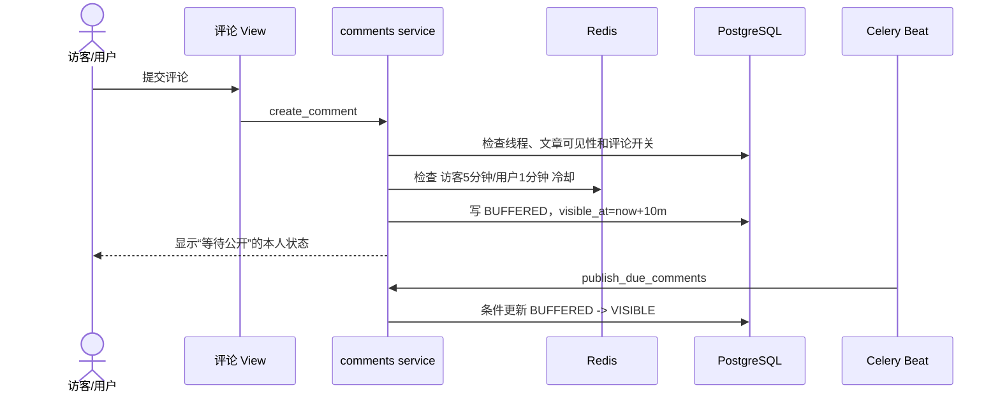
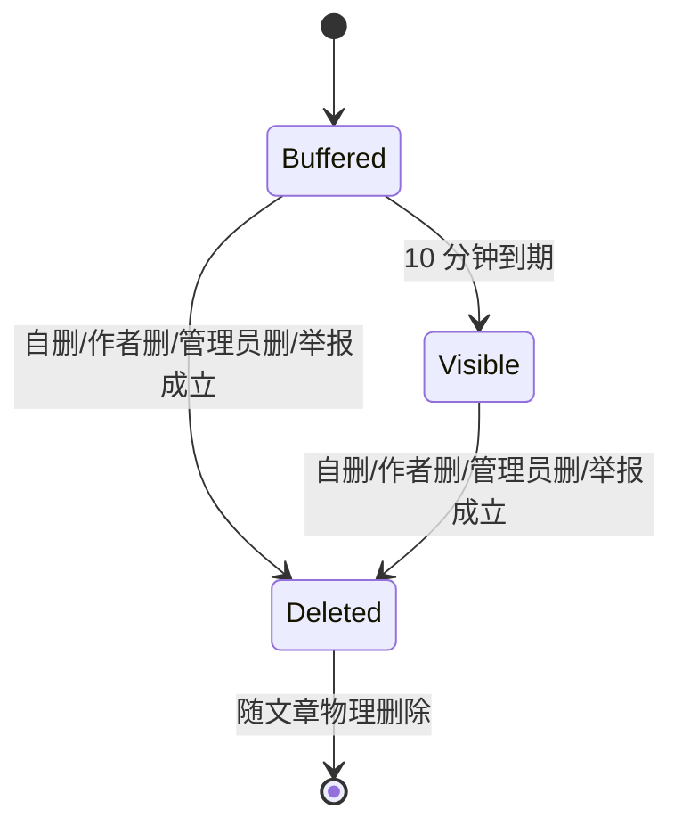
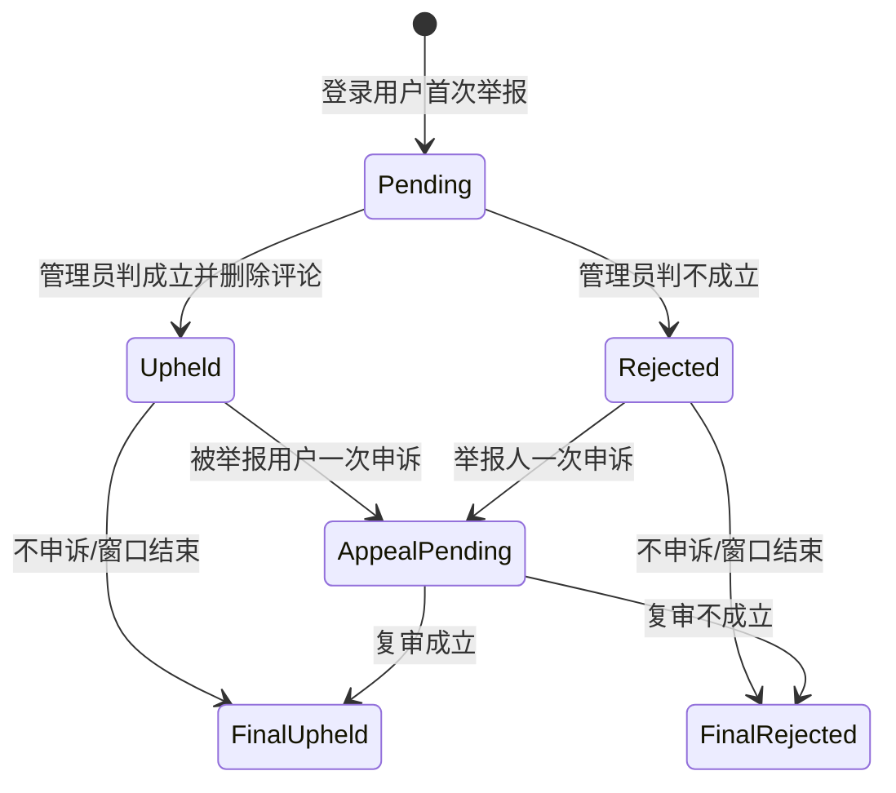

# 评论、举报与申诉状态机

## 评论提交

无论访客或登录用户都缓冲 10 分钟。作者/管理员可在缓冲期内删除。任务失败不会提前公开；恢复后幂等扫描所有到期缓冲评论。

## 创建权限

| 动作 | 访客 | 登录用户 | 文章作者 | 管理员 |
| --- | --- | --- | --- | --- |
| 查看评论 | 按文章设置 | 允许 | 允许 | 允许 |
| 顶层评论 | 文章允许且无需登录 | 允许 | 允许 | 允许 |
| 回复 | 禁止 | 允许 | 允许 | 允许 |
| 上传评论图 | 顶层最多 3 张 | 顶层最多 3 张 | 同左 | 同左 |
| 举报 | 禁止 | 允许一次/目标 | 允许 | 允许 |
| 删除自己评论 | 无账户入口 | 允许 | 允许 | 允许 |
| 管理文章评论 | 禁止 | 禁止 | 自己文章 | 全站 |

回复禁止图片；评论正文最多 100 字。被永久 IP 封禁的请求除公开浏览外全部拒绝。评论区关闭只阻止新建，不隐藏既有评论。

## 评论状态

进入 `Deleted` 时清空正文、立即解绑图片并保留“该评论已删除”节点。节点不可编辑、不可回复；其已有子回复继续显示。账户删除不是评论删除：保留原正文，将身份改为“该账号已注销”。

## 树与排序

- 深度无限，`depth > 100` 时对文章作者（留言板为管理员）只发一次深层提醒。
- 顶层默认最早在前；回复也最早在前。
- 最新排序：顶层创建时间倒序。
- 最热门：顶层 `reply_count` 倒序，时间为稳定二级排序。
- 顶层首次 20 条，滚动触底按 cursor 再取 20；每个回复链先 10 条，每次展开再取 10。
- 排序偏好只保存在浏览器，不同步账户。

## 举报初审

产品未指定申诉截止时间，因此首版不自动关闭申诉入口；“不申诉/窗口结束”只表示账户/目标被删除等业务关闭场景。复审是最终结果，不能再次申诉。

## 举报资料与隐私

- 初次举报：必选预设标签，可选 200 字描述，最多三张 2 MiB 证据图，并执行 `DEC-005` 解码上限。
- 申诉：最多 200 字和三张同规格图片。
- 同一举报人对同一评论只能举报一次，不能通过撤回重报绕过。
- 被举报方的通知、页面、导出都不显示举报人身份或媒体路径。
- 管理员详情可见举报人、完整证据和相关 IP；普通列表只显示必要摘要。

预设举报标签固定为：垃圾广告、辱骂骚扰、违法或危险内容、隐私泄露、无关内容、其他。新增标签通过迁移/注册表维护，不能让任意数据库字符串直接成为前端安全文案。

## 裁决副作用

| 结果 | 评论 | 通知 |
| --- | --- | --- |
| 初审成立 | 删除占位、图片立即删 | 举报人和被举报人；隐藏举报人身份 |
| 初审不成立 | 不改变 | 只通知举报人 |
| 申诉后最终成立 | 保持/执行删除 | 两方各收终局通知 |
| 申诉后最终不成立 | 若此前因举报删除，按保存的安全快照恢复可显示内容；无法恢复时保留占位并记录错误 | 两方各收终局通知 |

实现前需要注意：需求要求“成功举报即删除评论”又允许被举报者申诉。为了支持申诉成功恢复，初审删除不能立即销毁正文，必须在 moderation 私有证据区保留加访问控制的内容快照，直到终局；评论公开表仍只显示占位。终局成立后销毁快照，报告元数据永久保留。

## 管理员直接删除

管理员可绕过举报直接删除任何评论/回复：

- 删除为终局，无申诉。
- 可填原因；未填使用通用删除提示。
- 通知已登录评论作者和文章作者，若同一账户只发一条；访客评论不通知。
- 永久审计前后状态，只记录正文摘要/哈希，不在审计复制完整敏感正文。

## 留言板复用

留言板是管理员拥有的 `DiscussionThread`。默认开启、允许访客顶层留言；管理员可配置是否开启和是否要求登录。缓冲、冷却、图片、回复、排序、举报、占位和管理删除全部复用同一服务，不建立第二套留言模型。
