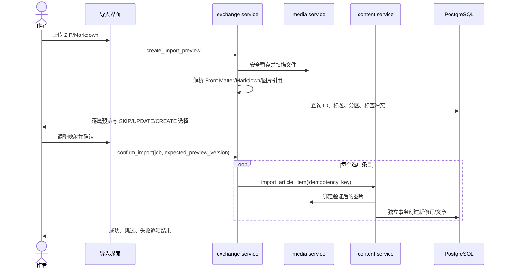
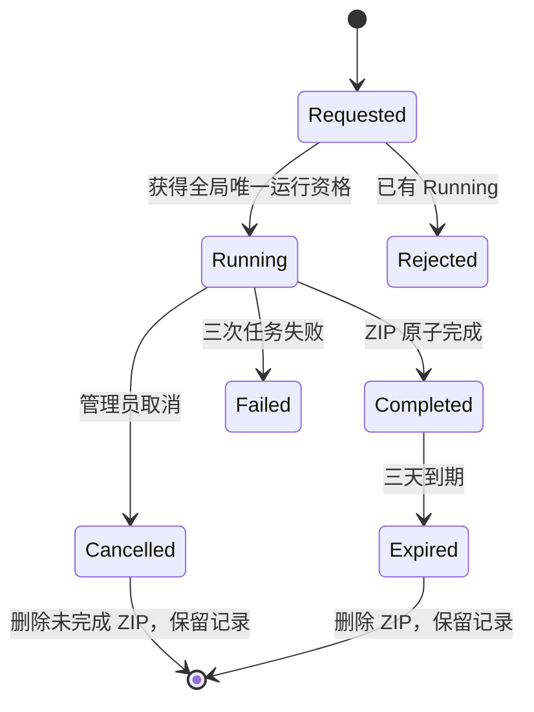
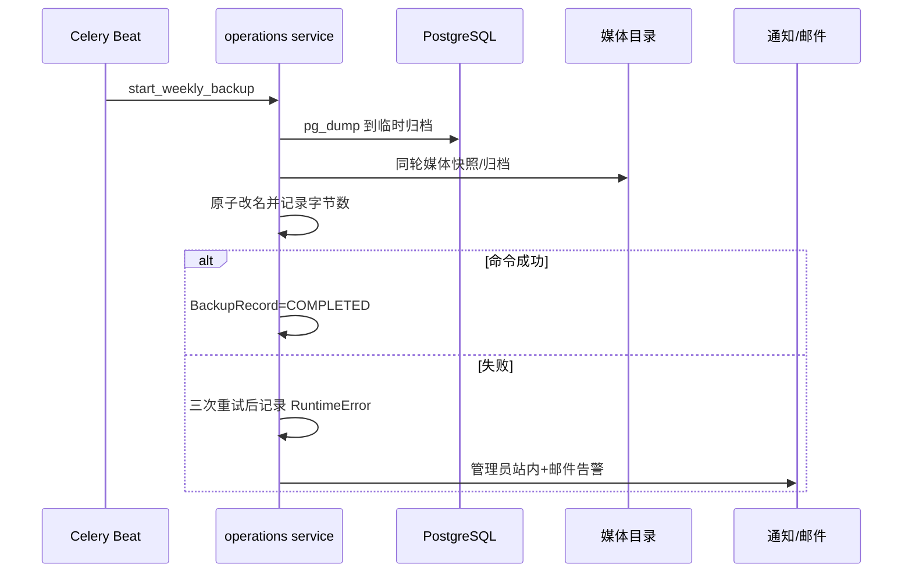
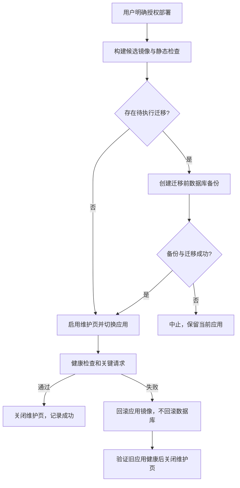

# 导入、导出、备份与部署时序

## Markdown 导入

导入分为“解析预览”和“确认写入”两个阶段，预览不得写文章、标签或媒体正式目录。

## 导入判定表

| 输入情况 | 默认判定 | 可选动作 |
| --- | --- | --- |
| 有 ID，属于导入者 | ID 重复 | 跳过、更新、另建 |
| 有 ID，属于他人 | 外部归属冲突 | 只能跳过；禁止更新/另建 |
| 无 ID，无同标题 | 新文章 | 新建或跳过 |
| 无 ID，有同标题且属于自己 | 疑似重复提示 | 跳过或新建；标题不作为更新键 |
| 无 ID，有同标题且属于他人 | 跨作者警告 | 可坚持新建；发布时通知管理员 |
| Markdown/引用图无效 | 无效项 | 跳过，继续其他条目 |

导入文章一律归属导入者。无法映射分区且作者未重选时进入未知分区。新标签创建为待审并立即关联。更新创建新修订并保留历史；覆盖富文本文章时允许把当前格式改为 Markdown，旧富文本仍在历史中。

`job_id + item_path/hash` 是幂等键。作者重复点击确认时，已成功项读回原结果，不再创建第二篇文章或第二个版本。导入不提供整批撤销。

## 导入包安全

- 解压前及流式解压时同时限制：压缩包不超 `64 MiB`、总展开量不超 `256 MiB`、项目数不超 `1000`、嵌套不超 `8` 层、任一条目和全包实际压缩比不超 `100:1`；超出即拒绝，不继续消耗剩余包内容。
- 使用结构化 ZIP API，解析后路径必须留在该 Job 暂存目录，拒绝 `..`、绝对路径、链接和设备文件。
- Front Matter 使用安全 YAML loader，只接受白名单字段和标量/列表类型。
- 图片必须经过统一 2 MiB、真实格式、解码、静态图 `8192`/`25 MP`、动图 `200` 帧/`100 MP` 累计解码和 EXIF 清理；正文也必须满足 `64 KiB` 至 `2 MiB` 的站点配置。
- Markdown HTML 仍走全站 sanitizer；预览也不能执行原始 HTML。

## 管理员导出

导出范围可为全站、作者、分区或选中文章；允许草稿、定时、私人和 7 天冷静期文章。包包含 JSON 元数据、Markdown 正文、全部历史版本和关联媒体。TipTap 历史版本需提供可逆、带格式标记的 JSON 源文件，另生成 Markdown 只作为便捷副本，不能伪装成无损转换。

下载通过管理员鉴权视图并校验 Job 状态/过期时间，再使用受控内部文件发送；不生成公开或可转发 URL。导出他人内容按作者和上海自然日通知，每位作者每天最多一条。

## 备份

调度固定为 `Asia/Shanghai` 每周一 03:00（`0 3 * * 1`），首版 destination 只能为 `local`。

备份保留 30 天、本地、不加密，不自动校验 dump 可读性、不做恢复演练。首版不展示或保存未实现的外部目标。文档必须诚实区分“命令返回成功”和“已验证可恢复”；本项目当前只承诺前者。恢复只能由服务器人工操作。

## 部署门禁

部署、迁移和服务重启只有用户当前明确唤起时才执行。批准后的顺序：

迁移必须向前兼容旧应用，否则应用自动回滚承诺无法成立。维护页从切换开始持续到新版本健康或旧版本回滚健康，不能用固定超时假装完成。

## 失败与取消语义

| 流程 | 部分结果 | 用户可重试 | 记录 |
| --- | --- | --- | --- |
| 导入 | 成功条目保留 | 可新建导入 Job；同 Job 确认幂等 | Job/Item 永久 |
| 导出 | 只暴露原子完成 ZIP | 运行中不能新建；失败需修 BUG 后新建 | Job/审计永久 |
| 备份 | 临时包不算成功 | 任务自动三次；无网页重试 | BackupRecord 永久 |
| 部署 | 迁移失败不切应用；健康失败回滚应用 | 由用户重新授权 | 部署/错误日志永久 |
